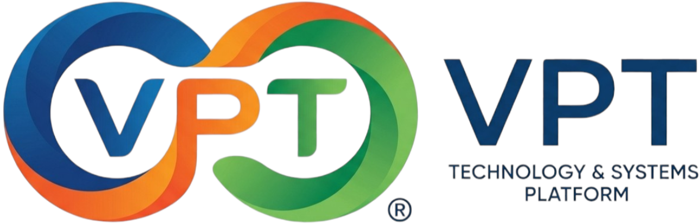

 

<h3>AI Engineer</h3>

 

## Hi, I'm Cuong

Software engineer working on backend systems and applied AI, based in Hanoi, Vietnam. My current focus is QC and data tooling for autonomous-driving perception: automated checks and release gates that make annotation workflows faster, more consistent and measurable.

### Focus areas

- **Backend engineering:** REST APIs, microservices and event-driven systems in Java and NestJS
- **Perception data tooling:** annotation QC for 2D, 3D and LiDAR data
- **Applied AI:** computer vision, LLMs and retrieval-augmented generation (RAG)

### Technologies

- **Languages:** Java, Python, JavaScript / Node.js
- **Backend:** REST APIs, NestJS, microservices, Kafka, Redis
- **Databases:** MySQL, PostgreSQL, MongoDB
- **DevOps:** Docker, Jenkins, GitLab CI/CD, Git, Linux
- **AI:** LLMs, RAG, Ollama, OpenCV

### Background

- Java backend development for exchange-side trading systems at HT Vietnam Group (Mercantile Exchange of Vietnam)
- NestJS backend development for healthcare and EHR platforms at Digi Dinos
- Published author in the Vietnam Journal of Artificial Intelligence (VJAI)
- B.Sc. in Information Technology; Applied AI program at VinUni (Vingroup AI20K)

### Connect

  
  
  
  

📧 Email: [hmc.it.vn@gmail.com](mailto:hmc.it.vn@gmail.com)
